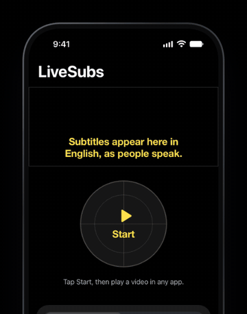

# LiveSubs

**English subtitles for any foreign-language video, made entirely on your iPhone.**

<p align="center">
  
</p>

Play a Japanese, Korean, Spanish… video in any app and read English subtitles in a floating
window. Or open it in LiveSubs' private browser, where the whole video is subtitled ahead of
playback in natural English. Speech recognition and translation run on the iPhone: no accounts,
API keys, cloud inference, analytics or backend, and nothing about what you watch is stored.

- **Live mode:** any app (YouTube, Safari, TikTok…) through screen-audio capture and Picture in
  Picture. Also in the Dynamic Island, on the Lock Screen and from Control Center.
- **Private browser:** subtitles prepared ahead of the playhead for the whole video, natural
  English from TranslateGemma, fullscreen controls, a built-in ad and tracker blocker, and
  nothing kept after you close it.
- **On-device engines:** Apple's speech recogniser, Apple Translation, TranslateGemma 4B (MLX)
  and Whisper (WhisperKit), chosen per language after measuring them (see below).

## Set up (once)

1. Install Xcode 27.2+ and XcodeGen (`brew install xcodegen`).
2. Create `Config/Signing.local.xcconfig` (git-ignored) with your own values:
   ```
   DEVELOPMENT_TEAM = ABCDE12345        // Xcode ▸ Settings ▸ Accounts; a free Personal Team works
   BUNDLE_ID_PREFIX = com.yourname
   APP_GROUP_ID = group.$(BUNDLE_ID_PREFIX).livesubs
   ```
   With a free Personal Team, apps expire after 7 days.
3. `xcodegen generate`, open `LiveSubs.xcodeproj`, choose your iPhone, Run.
   Xcode creates the App Group automatically with automatic signing.
4. In the app, follow the start guide: it downloads Apple's language packs and, if you want
   natural English, TranslateGemma (2.2 GB, once). The only network use is these downloads (and
   the pages you open in the private browser); afterwards Live mode works in Airplane Mode.

## Use

1. Tap **Start**. iOS asks to share screen audio. On iOS 27 that is the system screen-capture
   picker; on iOS 26 the "Start Broadcast" sheet for LiveSubs. Allow it.
2. Switch to YouTube, Safari, TikTok… and play a video.
3. English subtitles float above it (Picture in Picture). Drag, pinch, or park it at the edge.
4. Stop: tap **Stop** in the app, close the floating window, or tap the red recording pill.

Also: "Hey Siri, start LiveSubs", Shortcuts, the Action button, or the **Control Center button**
(App Shortcuts and a Control are included). **Microphone** mode listens to a TV or laptop nearby instead.
Subtitles also appear in the **Dynamic Island** and on the **Lock Screen** (Settings ▸ Dynamic Island).

### Private browser: subtitles ready in advance

Main screen ▸ **Private browser**, then paste a link to a page with a video. In fullscreen, tap
for LiveSubs' controls (play/pause, ±10 s, and a scrub bar whose yellow stretches already have
subtitles). Ads, trackers and pop-ups are blocked with ~150,000 bundled rules (EasyList,
EasyPrivacy, StevenBlack hosts; `Tools/make-blocklist.py`). LiveSubs copies the
audio the site's player has already downloaded (usually 30 s or more ahead), decodes it in memory
(`LiveSubs/Browser/FMP4AudioDecoder.swift`), and transcribes and translates it ahead of playback
(`AheadSubtitles.swift`). Lines appear on the video at the moment they're spoken, and go into the
video's own text track for fullscreen. At the start and after a jump, the video pauses briefly
until the first lines are ready (Settings ▸ Wait for subtitles).

Private by design: WebKit's non-persistent data store (no history, cookies or cache on disk),
subtitles kept in memory only, nothing logged, no Siri/Spotlight donations, and the screen is
covered when the app leaves the foreground so the app-switcher snapshot shows nothing. Closing the
browser discards everything. Works with sites that stream through Media Source Extensions (most
players, including Apple's ManagedMediaSource on iPhone) with AAC audio. Not supported yet:
sites that hand the video to the built-in player as a plain file or playlist (LiveSubs says so
and points to Live mode), and Opus audio. Protected (DRM) video is not readable by design.

### How the private browser makes subtitles (and why these engines)

Audio → **Apple's recogniser** (SpeechTranscriber) → **Apple Translation** (instant line) →
**TranslateGemma 4B** (Google, MLX, on the GPU) re-translates each line into natural English,
nearest lines first. Whisper is only the catch-all for languages Apple lacks and the language
detector when several languages are ticked (Settings ▸ Private browser ▸ Use Whisper instead).

Measured on Google FLEURS (native speakers; 40 Japanese + 40 Korean sentences joined into
~9-minute files, run through the browser's real engine, `Tests/Harness` `ahead:` mode):

| Engine | Japanese CER | Korean CER | Text kept |
|---|---|---|---|
| Apple's recogniser | **6.0%** | **6.3%** | ~100% |
| Parakeet TDT ja (FluidAudio) | 12.5% | – | 91% |
| Whisper large-v3 turbo | 12.3% | 15.5% | 90% |

On single short clips Whisper (3.2/4.6%) and Parakeet (3.9%) looked better; on long audio both
drop sentences. Parakeet stays in the Mac harness only. Translation (same sentences, chrF vs
FLEURS' professional English, plus casual dialogue read by hand): TranslateGemma 4B matched
Apple Translation on accuracy and was clearly more natural; an Apple Intelligence rewrite of
Apple's line read naturally but reversed a meaning once, so it was dropped; Llama 3.2 3B
invented details. TranslateGemma needs the GPU, which iOS doesn't allow from the background,
so it pauses when LiveSubs leaves the screen and isn't used in Live mode.

### Quality, style and Japanese/Korean

Live mode uses Apple's recogniser and Apple Translation when you've set one known language,
and Whisper when it has to detect the language. Settings ▸ **Quality** picks the Whisper size. Subtitle
**Style**: Live (white guess, then yellow), Steady (finished lines only), Automatic. Live mode
uses live-caption streaming: settled clauses are committed early and the unsettled English tail
is hidden until stable (`LiveSubs/Engine/StreamingStabilizer.swift`).

`Tests/Harness/bench.sh` compares setups on synthesized Japanese and Korean (first English, first
yellow line, end-of-speech lag, flicker). On a Mac: Small mistranslated a Korean negation; Turbo +
Apple Translation and the Apple engine translated 8/8 lines correctly; reading a whole file runs
about 17× real time. iPhone timings are not measured yet; the practice clip shows the delay on
your iPhone.

## How it works

| Piece | iOS 26 | iOS 27 |
|---|---|---|
| Capture other apps' audio | ReplayKit broadcast extension → 16 kHz mono into a memory-mapped ring buffer in the App Group (`Shared/AudioRingBuffer.swift`) | ScreenCaptureKit `SCStream` audio, in-process, `screen-capture` background mode (`LiveSubs/Audio/ScreenCaptureAudioSource.swift`); the extension remains as a fallback in Settings ▸ Advanced |
| Keep running behind other apps | Active Picture in Picture plus a mixable `.playback` audio session | Same, plus `screen-capture` |
| Floating subtitles | Text drawn into video frames on an `AVSampleBufferDisplayLayer`, shown with `AVPictureInPictureController` (iOS forbids overlays on other apps; PiP is the sanctioned floating surface) | Same |
| Speech → English, automatic language | WhisperKit (CoreML/Neural Engine): energy VAD segments, partial passes every ~1 s, final pass at pauses, language voting, hallucination filter | Same |
| Speech → English, Apple engine | SpeechAnalyzer/SpeechTranscriber + Translation framework (you choose the language; Apple has no spoken-language detection) | Same |

Models come from huggingface.co/argmaxinc/whisperkit-coreml (OpenAI Whisper, MIT license):
Tiny 75 MB, Base 145 MB, **Small 216 MB (default)**, Small full 480 MB, Large v3 Turbo 626 MB
(accurate recognition; translates only through Apple language packs, because OpenAI's turbo
model was not trained to translate), Large v3 947 MB (slow on phones).

## What works, what needs a device, what iOS does not allow

- **Verified on a Mac** (`Tests/Harness/run.sh`, real engine sources, real-time feed):
  Spanish and German speech are detected automatically and translated. With Small, the first
  English words appear about 1.2–1.4 s after speech starts. The ring buffer and the
  big-endian `.audioApp` converter are checked too.
- **Builds** for iPhone and Simulator. Picture in Picture and capturing other apps' audio
  cannot run in the Simulator; they need an iPhone.
- **Not yet confirmed on hardware:** whether YouTube's audio reaches ScreenCaptureKit on iOS 27
  (Apple does not document it; some apps deliver silence). If you see "No audio is coming
  through", switch Settings ▸ Advanced ▸ Capture method to the broadcast extension.
- **iOS does not allow:** drawing over other apps (hence PiP), capturing DRM-protected audio
  (Netflix, Apple TV+ and the like may be silent; this app does not bypass it), or starting
  capture without your on-screen consent each session.
- Whisper is CPU/Neural-Engine heavy; expect noticeably higher battery use than video alone.
  The Apple engine is the most efficient choice when you know the language.

## Layout

```
Config/Signing.xcconfig        signing defaults; your values go in Signing.local.xcconfig
Shared/                        ring buffer, Darwin notifications, audio converter (app + extension)
BroadcastExtension/            ReplayKit sample handler (iOS 26 path)
LiveSubs/Audio                 broadcast reader, ScreenCaptureKit source, microphone
LiveSubs/Engine                recognisers (Apple, Whisper), Apple pipeline, TranslateGemma
LiveSubs/Browser               private browser, audio decoding, ahead-of-time subtitles, ad blocking
LiveSubsControls               Control Center button and Live Activity
LiveSubs/Subtitles             PiP controller and frame renderer
LiveSubs/UI, App, Models       SwiftUI screens, session orchestration, model manager
Tests/Harness                  macOS end-to-end engine checks and benchmarks
Tools/make-blocklist.py        builds the bundled ad-blocking rules
Showcase/                      the animated demo above (Stageshow, React)
PRODUCT.md, DESIGN.md          product record and design system
```

## The demo animation

`docs/demo.gif` is filmed from `Showcase/`, an illustration built with Stageshow by Benji Taylor.
Its subtitle lines are made up for the demo. To change it: `cd Showcase && npm install && npm run dev`;
`npm run build` writes a single self-contained `dist/index.html`.

## Credits

LiveSubs stands on the work of Argmax (WhisperKit), OpenAI (Whisper), Google (TranslateGemma,
FLEURS), Apple's MLX team (mlx-swift, mlx-swift-lm), Hugging Face (swift-transformers), the
EasyList authors and Steven Black (blocking rules), FluidInference (FluidAudio, used in the
harness), Benji Taylor (Stageshow), and yuxino/osu (the idea of Picture in Picture subtitles).
Licences and links for every dependency, model and dataset are in
[THIRD_PARTY_NOTICES.md](THIRD_PARTY_NOTICES.md).

## Licence

LiveSubs' own code is MIT licensed ([LICENSE](LICENSE)). Third-party code, models and blocking
rules keep their own licences, listed in [THIRD_PARTY_NOTICES.md](THIRD_PARTY_NOTICES.md); in
particular the bundled EasyList/EasyPrivacy rules stay under CC BY-SA 3.0, and TranslateGemma
is subject to the Gemma Terms of Use.
